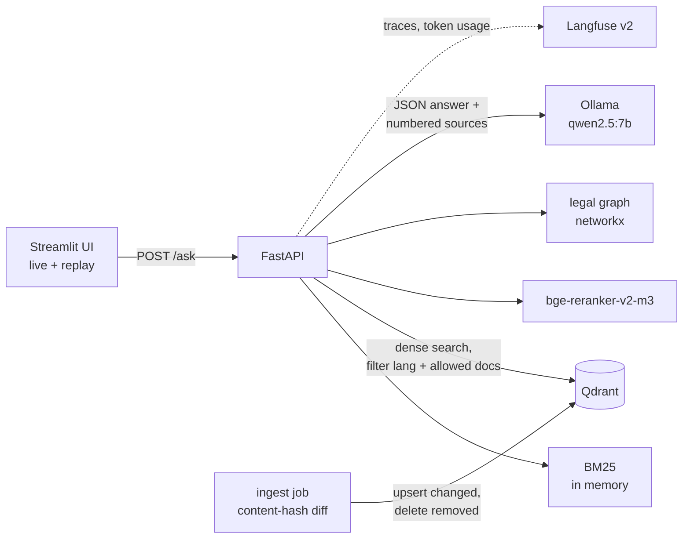

# EU AI Act & GDPR compliance assistant (RAG)

Question answering over the **EU AI Act** and the **GDPR**, in English and Swedish, that cites the exact
article and paragraph it relies on and says so when the regulations do not answer the question.
Everything runs locally on open models, and every design choice is measured on a hand-built benchmark.

> Status: steps 1 to 3 of 5 done, step 4 half done (rule-based GraphRAG). Next: LLM-extracted graph
> comparison, incremental re-indexing and the demo; see the [roadmap](#roadmap).

## Why this is not another "chat with a PDF"

| | Typical PDF chatbot | This project |
|---|---|---|
| Source | One PDF, fixed-size chunks | Official EUR-Lex HTML, parsed into articles, paragraphs, points, annexes, recitals |
| Law version | Whatever PDF was downloaded | **Current law**: AI Act as amended by the Digital Omnibus on AI (Reg. (EU) 2026/1744), with the 2024 text kept for comparison |
| Citations | "page 37" | `AI Act Art. 26(6)`, stable ids shared across languages |
| Languages | English | English and Swedish, ids aligned across both |
| Evaluation | None | 94 questions with gold provisions, incl. unanswerable, false-premise and amendment-sensitive questions |

## Corpus

Built by [`scripts/download_corpus.py`](scripts/download_corpus.py) and [`scripts/build_corpus.py`](scripts/build_corpus.py).

| | English | Swedish |
|---|---|---|
| AI Act articles / annexes / recitals | 119 / 14 / 180 | 119 / 14 / 180 |
| GDPR articles / recitals | 99 / 173 | 99 / 173 |
| Words | 146k | 132k |
| AI Act provisions changed by the 2026 amendment | 35 | 36 |

Sources: consolidated texts `02024R1689-20260727` and `02016R0679-20160504` for articles and annexes (the
law as in force), the Official Journal versions `32024R1689` and `32016R0679` for recitals (consolidated texts
omit them), and `32024R1689` again as the 2024 baseline for the amendment experiments.

Each provision keeps its chapter and section, paragraph numbers, list points, the amending act that changed it
(from EUR-Lex `▼M1` markers), and cross-references extracted in both languages
(`Article 6(2)` / `artikel 6.2`, `Annex III` / `bilaga III`, `Article 22 of Regulation (EU) 2016/679` → `GDPR:art_22`).
The cross-reference graph is the input for the planned GraphRAG comparison.

### Chunking strategies (ablation)

| Strategy | What a chunk is | EN chunks | Median words |
|---|---|---|---|
| `structural` | One paragraph / annex point / recital; long paragraphs split at list points with the lead-in sentence repeated; breadcrumb header (`AI Act > Chapter III > Section 1 > Article 6 – Classification rules … > paragraph 3`) | 1,518 | 67 |
| `article` | One whole article / annex / recital | 585 | 165 |
| `fixed` | 200-word sliding window, 40 overlap, no structure (baseline) | 929 | 200 |

## Benchmark

[`eval/questions.jsonl`](eval/questions.jsonl), generated from [`eval/questions_src.py`](eval/questions_src.py):
94 questions, 78 English and 16 Swedish.

| Category | n | Example |
|---|---|---|
| definition, obligation, prohibition, threshold, scope, rights, procedure | 58 | *How long must deployers keep the logs generated by a high-risk AI system?* |
| multi_hop (needs two provisions) | 5 | *Is an AI tool that screens job applications high-risk?* (Annex III + Art. 6) |
| cross_regulation (AI Act + GDPR) | 5 | *If I already did a DPIA, do I still need a fundamental rights impact assessment?* |
| amendment (answer changed in 2026) | 12 | *From when do obligations for Annex III high-risk systems apply?* 2 Dec 2027, was 2 Aug 2026 |
| unanswerable | 11 | *Which Swedish authority supervises the AI Act in Sweden?* |
| false_premise | 3 | *What compute threshold makes an AI system high-risk?* (none: 10^25 FLOP is for GPAI models) |

Every question lists gold provision ids, and evidence strings that
[`eval/check_questions.py`](eval/check_questions.py) verifies against the corpus on every CI run, so labels
cannot silently drift from the text. Amendment questions also store the 2024 answer, and the check confirms
their evidence is absent from the 2024 text.

## Retrieval results

`python eval/retrieval_eval.py`: 80 answerable questions, top 5 chunks, everything on CPU.
`evidence@5` is the strict metric: the passage that contains the answer is inside a retrieved chunk of the
right provision. Full grid (2 embedding models x 3 chunkings x 3 language pairs) in
[`eval/results/retrieval.json`](eval/results/retrieval.json).

**Retriever ablation** (structural chunks, English questions, n = 66)

| Retriever | hit@5 | recall@5 | MRR@5 | evidence@5 |
|---|---|---|---|---|
| BM25 | 0.742 | 0.697 | 0.614 | 0.682 |
| Dense, multilingual-e5-small | 0.773 | 0.742 | 0.577 | 0.667 |
| Dense, bge-m3 | **0.939** | **0.894** | 0.749 | 0.894 |
| Hybrid (BM25 + bge-m3, RRF) | 0.803 | 0.765 | 0.665 | 0.773 |
| Hybrid + bge-reranker-v2-m3 | **0.939** | **0.894** | 0.718 | **0.909** |

**Chunking ablation** (hybrid + reranker, English questions)

| Chunking | hit@5 | recall@5 | MRR@5 | evidence@5 |
|---|---|---|---|---|
| structural (paragraph level) | 0.939 | 0.894 | 0.718 | **0.909** |
| fixed 200-word windows | 0.939 | 0.879 | **0.769** | 0.864 |
| whole article | 0.833 | 0.795 | 0.629 | 0.833 |

**Swedish questions** (structural chunks, n = 14; small sample, read as indicative)

| Retriever | SV → SV index hit@5 | SV → EN index hit@5 |
|---|---|---|
| BM25 | 0.786 | 0.000 |
| Dense, multilingual-e5-small | 0.857 | 0.429 |
| Dense, bge-m3 | 0.786 | **0.929** |
| Hybrid + reranker | **1.000** | 0.857 |

What the numbers say:

1. **Naive hybrid search made things worse.** Fusing BM25 into bge-m3 with equal-weight RRF dropped hit@5
   from 0.94 to 0.80. Users ask in plain language ("Must a chatbot tell users it is an AI?") while the law says
   "AI systems intended to interact directly with natural persons", so the keyword ranking is mostly noise
   and RRF gives it half the vote. The reranker repairs this, but hybrid only matched dense, it did not beat it.
   "Hybrid is always better" does not hold on this corpus.
2. **The embedding model matters most for cross-lingual search.** Swedish questions against the English
   index: bge-m3 0.93, multilingual-e5-small 0.43, BM25 0.
3. **Whole-article chunks are clearly worst**, and e5-small collapses on them (0.44 hit@5) because its 512-token
   limit truncates long articles. Fixed windows are competitive on hit@5, but structural chunks find the
   answer passage more often (0.91 vs 0.86) and are the only ones that can be cited at paragraph level.
4. **Remaining failures are structural, not semantic.** Both date questions miss Art. 113 ("Entry into force
   and application"), whose text is a list of chapter numbers and dates with no topical words; and for
   cross-regulation questions recitals crowd articles out of the top 5. These are the cases the
   cross-reference graph (GraphRAG) and an article-over-recital prior are meant to fix.

Cost on 4 CPU cores: embedding 1,518 structural chunks takes about 10 minutes with bge-m3 and 50 seconds with
e5-small; reranking 30 candidates takes about 10 seconds per question. A GPU brings both to interactive speed.

## Generation results

Local models through Ollama on an RTX 4060 laptop GPU (8 GB), temperature 0, top-5 sources from the
structural hybrid + reranker pipeline frozen in [`eval/contexts/`](eval/contexts) so every model sees the same
evidence. The model must answer in JSON with the numbers of the sources it used, or set `insufficient`.
"Closed book" is the same model with no sources. Scored by [`eval/score_generation.py`](eval/score_generation.py).

| | qwen2.5:7b RAG | qwen2.5-coder:7b RAG | qwen2.5:7b closed book | qwen2.5-coder:7b closed book |
|---|---|---|---|---|
| Correct, answerable questions (n = 80) | **0.875** | 0.775 | 0.313 | 0.163 |
| English / Swedish | 0.879 / 0.857 | 0.773 / 0.786 | 0.318 / 0.286 | 0.182 / 0.071 |
| Amendment questions, current law (n = 12) | **0.750** | 0.583 | 0.000 | 0.000 |
| Refuses unanswerable questions (n = 11) | 0.818 | 0.727 | 0.545 | 0.818 |
| Refuses answerable questions | **0.000** | 0.037 | 0.088 | 0.513 |
| Corrects a false premise (n = 3) | 1 of 3 | 1 of 3 | 1 of 3 | 1 of 3 |
| Cites a gold provision | 0.915 | 0.897 | – | – |
| Citation precision | 0.659 | 0.701 | – | – |
| Median latency | 5.1 s | 4.6 s | 3.8 s | 3.4 s |

Correctness is checked with answer keys: the decisive facts of each reference answer (numbers, dates,
yes/no, named concepts) as regular expressions, verified in CI to accept the reference answer and, for
amendment questions, to reject the 2024 answer. A manual read of 22 randomly sampled "correct" answers found
no false positives; the keys were loosened once after reading outputs (thousand separators, Swedish
negation, two too-narrow phrasings).

What the numbers say:

1. **Retrieval is the whole game for a 7B model.** Closed book, qwen2.5:7b gets 31 % right; with sources,
   88 %. On questions about the 2026 amendment it scores 0 % without sources: it does not give the old 2024
   rule either, it invents dates ("16 December 2024", an "Article 5(3)" ban). With sources it gets 75 %.
2. **A general instruction model beats the coder model by 10 points** with identical evidence. Without
   sources the coder model mostly refuses (51 % of answerable questions), which looks safe but is useless.
3. **Of the 10 wrong RAG answers from qwen2.5:7b, 4 are retrieval misses and 6 are generation errors.** The
   retrieval misses are the Art. 113 date questions and two cross-regulation questions, the same failures the
   retrieval ablation predicted. Generation errors are mostly picking the wrong item from a correct list
   (Art. 73: "10 days", the deadline for deaths, instead of the general 15 days) or dropping an exception.
4. **Near-miss context causes the worst errors.** The model answered "What is the maximum fine under the UK
   GDPR?" with the EU GDPR's Art. 83(4) figures, and a question on notified-body costs with the AI Act's fee
   provision. Retrieved text that is about the right topic but the wrong jurisdiction is more dangerous than
   no text, and refusal (82 %) is not yet good enough for a compliance tool.
5. **False premises mostly get through** (1 of 3 corrected in every setting), e.g. accepting that the AI Act
   bans all biometric identification.

One closed-book coder run looped until timeout on one Swedish question; all runs now cap output at 512
tokens (no other answer came near it: the longest was 312 tokens).

## GraphRAG: rule-based legal graph

[`src/lexrag/graph/`](src/lexrag/graph). The graph is built with rules only, because EU law is already
structured and the structure is exact; an LLM extraction layer is planned as a comparison.

| Layer | Nodes | Edges (English graph) |
|---|---|---|
| Structure | 597 provisions, 1,518 paragraph chunks | `CONTAINS` 1,518 · `REFERS_TO` 1,067 (cross-references, incl. AI Act → GDPR) |
| Concepts | 96 defined terms (AI Act Art. 3, GDPR Art. 4) | `DEFINED_IN` 96 · `SAME_AS` 8 (e.g. AI Act "biometric data" ↔ GDPR Art. 4(14)) |
| Time | | `APPLIES_FROM` 314 (every article → the act's entry-into-force article) |

At query time the reranked hybrid results seed a one-hop expansion: definitions of terms named in the
question (and the equivalent definition in the other act), provisions the top passages cite, passages that
cite them, and for "when / from when / by when" questions the entry-into-force article. The union is
reranked again. The Swedish graph is built the same way from the Swedish text.

**Retrieval** (structural chunks, top 5; same reranker everywhere)

| | EN hit@5 | EN evidence@5 | SV → EN hit@5 |
|---|---|---|---|
| Hybrid + reranker (pool 30) | 0.939 | 0.909 | 0.857 |
| Control: hybrid + reranker, pool 50 | 0.939 | 0.909 | 0.857 |
| Graph expansion + reranker | 0.955 | 0.924 | 0.929 |
| Hybrid + reranker, at most 1 recital in top 5 | 0.955 | 0.955 | 0.929 |
| Graph expansion + reranker, at most 1 recital | 0.970 | 0.970 | 1.000 |
| **… + date slot pinned for "when does X apply" questions** | **0.985** | **0.985** | **1.000** |

The control shows the gain comes from the graph, not from a larger candidate pool. Inspecting the misses
showed that after expansion the gold provision was usually in the pool but lost the reranker to recitals,
which restate the topic in plain words but do not bind. Capping recitals at one per answer fixed most of
that, and the two changes add up. With 66 English questions one question is 1.5 points, so read the
differences as directional.

**Date slot.** On the laptop GPU run, a Swedish paraphrase of the Annex III date question ("När gäller
skyldigheterna …") was answered wrongly. Graph expansion had added Art. 113, but the reranker's scores for
Swedish candidates were saturated between 0.96 and 0.99 and it placed Art. 113 at rank 22. When a question asks
for an application date (a "when" word plus apply / in force / tillämpas / gäller; "when is a DPIA required" does
not count), the best date chunk found by the graph now gets a reserved slot in the top 5. It changes 3 of the
94 questions: one more hit (amd-02, Annex I dates) and no losses (`eval/results/retrieval_pin.json`). The API
uses this configuration.

**Generation** (qwen2.5:7b, same prompt, graph contexts vs hybrid contexts)

| | Hybrid contexts | Graph contexts |
|---|---|---|
| Gold provision in the 5 sources (n = 83) | 78 | **81** |
| Correct, answerable (n = 80) | 0.875 | 0.888 |
| Amendment questions (n = 12) | 0.750 | **0.833** |
| Cites a gold provision | 0.915 | **0.963** |
| Citation precision | 0.659 | **0.736** |
| Refuses unanswerable questions (n = 11) | 0.818 | 0.727 |
| Corrects a false premise (n = 3) | 1 of 3 | 2 of 3 |

The graph's clearest win is grounding: citations point to the right provision more often and more
precisely, and the Annex III date question is now answered correctly ("2 December 2027 ... and 2 August
2028"). Answer accuracy moves less, because most remaining errors are generation errors. The cost is one
more hallucinated answer on an unanswerable question: asked which Swedish authority supervises the AI Act,
the model, given more governance articles, named the European Data Protection Supervisor. More related
context makes refusing harder, which is the main open problem for step 5.

### Round 2: a graph from LLM-extracted triples

qwen2.5:7b read each of the 1,135 English article and annex chunks and returned up to 8
(subject, relation, object) triples with a fixed relation set (`scripts/extract_triples.py`, JSON mode).
On the laptop GPU this took 1 h 33 min (5.0 s per chunk); every reply parsed, 47 chunks gave no triples,
3,556 triples in total (MUST 1,485, APPLIES_TO 567, DEFINED_AS 405, MAY 373, REQUIRES 310, MUST_NOT 150,
EXEMPTS 128, APPLIES_FROM 116, PENALTY 22). Questions link to entities by bge-m3 similarity, so Swedish
questions reach the English entity names; the Swedish graph reuses the triples through the aligned chunk ids
(`src/lexrag/graph/llm_graph.py`).

| Structural chunks, top 5, at most 1 recital | EN hit@5 | EN evidence@5 | SV → EN evidence@5 |
|---|---|---|---|
| No graph | 0.955 | 0.955 | 0.857 |
| LLM graph | 0.955 | 0.955 | 0.857 |
| LLM graph, entities merged at cosine ≥ 0.85 | 0.955 | 0.955 | 0.857 |
| Rule graph | 0.970 | 0.970 | 1.000 |
| Rule + LLM graph | 0.970 | 0.970 | 0.929 |
| Rule graph + date slot | **0.985** | **0.985** | **1.000** |

The LLM graph adds nothing measurable here, and adding it to the rule graph costs one Swedish question.
Why:

- **The entities do not connect.** 3,540 distinct entity names came out of 3,556 triples, and 90 % of them
  occur in a single chunk, because objects are free-text clauses ("monitor operation of high-risk ai
  system"). Merging names by embedding similarity (cosine ≥ 0.85) brings 3,540 names down to 2,780, but
  only 565 of those link two chunks or more. The few hubs ("provider", "controller") are too generic to help.
- **What retrieval still missed is not what the LLM extracted.** The remaining misses were dates
  (Art. 113) and definitions. The rule graph targets them with exact edges: every article → its
  application-date article, and every term → its definition. The LLM produced only 116 APPLIES_FROM triples,
  attached to the chunk that states the date. That chunk is not linked to the questions that need it.
- The LLM extras changed the top 5 in 19 of the 94 question runs: one Swedish question searched in English became a hit (sv-04),
  another lost its evidence paragraph (sv-10), and nothing else changed in the metrics.

For this corpus, explicit legal structure (cross-references, definitions, application dates) beats an
open-schema LLM graph, at no GPU cost. An LLM graph would need a closed entity vocabulary (e.g. the
defined terms and actor roles), which is the next thing to try. The triples are committed in
`data/graph/triples_qwen2.5_7b.jsonl`.

## Serving: API, UI and deployment



One request runs the configuration that scored best in the evaluation: BM25 + bge-m3 → RRF (30) →
reranker → graph expansion from the top 10 → reranker → top 5 with at most one recital → LLM.
Every citation links to the paragraph on EUR-Lex.

| Endpoint | What it does |
|---|---|
| `GET /health` | LLM reachable, chunks loaded, graph built |
| `POST /search` | retrieval only, with the reason each source was added (`retrieval` or `graph: …`) |
| `POST /ask` | answer, refusal flag, citations (label, URL, cited or not), timings, token counts |
| `GET /roles` | the access roles |

**Access filtering.** `configs/access.json` maps a role to the documents it may read
(`public` → both, `dpo` → GDPR, `ai-governance` → AI Act). The filter is applied in BM25, in the
Qdrant payload filter and to graph expansion, so a graph edge cannot leak a chunk from a document the
role cannot see. Unknown roles get 403.

**Incremental re-indexing.** Each stored chunk carries a SHA-1 of its header and text. Re-ingestion diffs
the new chunk set against the store and embeds only new or changed chunks
(`python scripts/ingest.py --demo`, results in `eval/results/ingest_demo.json`). Loading the AI Act as
published in 2024 and then the text amended by Regulation (EU) 2026/1744:

| | chunks (2026) | added | changed | removed | unchanged (vector reused) |
|---|---|---|---|---|---|
| English | 1,518 | 89 | 86 | 22 | 1,343 (88 %) |
| Swedish | 1,505 | 86 | 81 | 17 | 1,338 (89 %) |

So the amendment costs 175 embeddings instead of 1,518 in English.

**Replay mode.** The UI also browses the 94 benchmark questions with the answers qwen2.5:7b gave on
graph contexts and their scores (`app/replay.json`, built by `scripts/build_replay.py`), so the demo runs
without a GPU or a running API. A "only failures" filter shows the error cases discussed above.

**Tracing.** With `LANGFUSE_PUBLIC_KEY` set, each `/ask` becomes a Langfuse trace with retrieve and rerank
spans and the LLM generation (prompt, output, token usage). Without it tracing is a no-op.

### Docker Compose

```bash
cp .env.example .env
docker compose up -d --build        # Qdrant, ingest job, API on :8000, UI on :8501
# LLM: Ollama on the host by default (OLLAMA_URL in .env), or in a container:
docker compose --profile ollama -f docker-compose.yml -f docker-compose.gpu.yml up -d
docker compose exec ollama ollama pull qwen2.5:7b
docker compose --profile tracing up -d   # Langfuse on :3000
```

The first ingest downloads bge-m3 into the `models` volume and embeds the corpus on CPU; later runs only
embed what changed. Measured against Qdrant in server mode on a cloud CPU (no GPU): retrieval 0.1–1.4 s and
reranking with graph expansion 17–30 s per question, so put the reranker on a GPU (`EMBED_DEVICE=cuda`)
for interactive use.

**On a laptop GPU** (RTX 4060 Laptop 8 GB, no Docker, `scripts/run_local.ps1`; raw results in
`eval/results/local_gpu_run.json`): embedding the whole corpus takes about 40 s per language
(the first run, which also downloads bge-m3, took 169 s), and the second ingest finishes in 1.4 s with nothing re-embedded.
A full `/ask` takes 8.6–11.7 s, almost all of it generation:

| Question (role) | wall | retrieve | rerank + graph | generate | outcome |
|---|---|---|---|---|---|
| Annex III application date (public) | 9.1 s | 1.4 s | 0.02 s | 5.7 s | correct: 2 Dec 2027 / 2 Aug 2028 (amended dates) |
| same, in Swedish (public) | 11.7 s | 1.2 s | 0.01 s | 8.4 s | wrong: date provision not retrieved |
| Article 5 fine (dpo → GDPR only) | 9.5 s | 1.2 s | 0.02 s | 6.3 s | GDPR Art. 83(5): EUR 20 M or 4 % |
| Article 5 fine (ai-governance → AI Act only) | 8.6 s | 1.2 s | 0.02 s | 5.3 s | AI Act Art. 99(3): EUR 35 M or 7 % |
| Deployer duties before use (public) | 9.6 s | 1.1 s | 0.01 s | 6.5 s | right duties, but a recital ranks above Art. 26/27 |
| UK GDPR (public) | 10.2 s | 1.2 s | 0.01 s | 6.9 s | flags insufficient, but pads with outside knowledge |

The same question about "Article 5" resolves to different laws depending on the role, which is what the
access filter is for. Retrieval at ~1.2 s is mostly the embedded (file-mode) Qdrant filtering in Python;
Qdrant in server mode is faster. Rerank + graph shows near 0 because these questions had been asked in earlier attempts and their reranker scores came from the reranker's cache; uncached reranking on this GPU was not measured in this run. The stage timings sum to 2–2.5 s less than the wall time; `/ask` now also reports `total` so the gap can be located.

### Without Docker (Windows, GPU)

```powershell
powershell -ExecutionPolicy Bypass -File scripts\run_local.ps1
```

Creates a venv with CUDA torch, builds the chunks, embeds them into Qdrant in local file mode
(`data/qdrant`, no server), pulls the model into the local Ollama and starts the API (:8000) and UI (:8501).
Elsewhere: `pip install -e ".[dense,serve,ui]"`, `python scripts/ingest.py --qdrant-path data/qdrant`,
then `QDRANT_PATH=data/qdrant uvicorn lexrag.serve.api:app` and `streamlit run app/streamlit_app.py`.

## Run it

### Windows step by step (local GPU, no Docker)

Needs Git, Python 3.11+, an NVIDIA GPU and [Ollama](https://ollama.com).

```powershell
git clone https://github.com/YiYang-09/eu-ai-act-rag.git
cd eu-ai-act-rag
ollama pull qwen2.5:7b

# 1. first time: venv, CUDA torch, chunks, embeddings into data\qdrant; then starts API + UI
powershell -ExecutionPolicy Bypass -File scripts\run_local.ps1
# later: start only
powershell -ExecutionPolicy Bypass -File scripts\run_local.ps1 -SkipSetup
```

The UI opens at http://localhost:8501 (Live mode asks the API, Replay mode needs nothing running),
the API docs at http://localhost:8000/docs. Only the UI, without GPU or API:
`.venv\Scripts\python -m streamlit run app\streamlit_app.py`.

Evaluation, in the same venv (`.venv\Scripts\activate`):

```powershell
pip install -e ".[dev]"
pytest                                                      # unit tests, no models
python eval\retrieval_eval.py --retrievers bm25            # keyword baseline, seconds
python scripts\embed_corpus.py --device cuda               # vectors for all models and chunkings
python eval\retrieval_eval.py --device cuda                # full retrieval ablation
python eval\retrieval_eval.py --retrievers hybrid+rerank --models bge-m3 --strategies structural `
  --rerank-strategies structural --graph --max-recitals 1 --pin-dates --device cuda   # best config
python scripts\build_contexts.py --graph --max-recitals 1 --device cuda `
  --out eval\contexts\graph_rerank_top5.jsonl              # freeze top-5 sources per question
python scripts\run_generation.py --model qwen2.5:7b --mode rag `
  --contexts eval\contexts\graph_rerank_top5.jsonl --tag graph   # needs Ollama running
python eval\score_generation.py                            # correctness, citations, refusal
```

### Linux / macOS

```bash
pip install -e ".[dev]"
python scripts/download_corpus.py      # optional: re-download EUR-Lex HTML into data/raw/
python scripts/build_corpus.py         # parse (if data/raw exists) and chunk
python eval/check_questions.py
python eval/retrieval_eval.py --retrievers bm25   # keyword baseline, no models needed
pip install -e ".[dense]"
python scripts/embed_corpus.py                    # add --device cuda on a GPU
python eval/retrieval_eval.py                     # full ablation
python scripts/build_contexts.py                  # freeze top-5 sources per question
python scripts/run_generation.py --model qwen2.5:7b --mode rag   # needs Ollama
python eval/score_generation.py
pytest
```

The parsed provisions are committed, so everything except re-parsing works without downloading.

## Roadmap

1. ~~Corpus, structure-aware chunking, cross-references, benchmark, BM25 baseline~~
2. ~~Dense retrieval with BAAI/bge-m3 (vs multilingual-e5-small), hybrid fusion, bge-reranker-v2-m3~~
3. ~~Local generation (Ollama, Qwen2.5) with forced article citations and refusal when evidence is missing;
   citation accuracy and refusal accuracy~~
4. ~~Rule-based GraphRAG over the cross-reference graph; LLM-extracted graph as a comparison~~
5. ~~FastAPI + Streamlit demo, Docker Compose (Qdrant, API, Ollama, Langfuse tracing), access filtering by
   metadata, incremental re-indexing (2024 → 2026), CI gates~~

## Data licence

EUR-Lex content © European Union, reused under Commission Decision 2011/833/EU. Only the European Union's
official Journal is authentic; this project is not legal advice.
